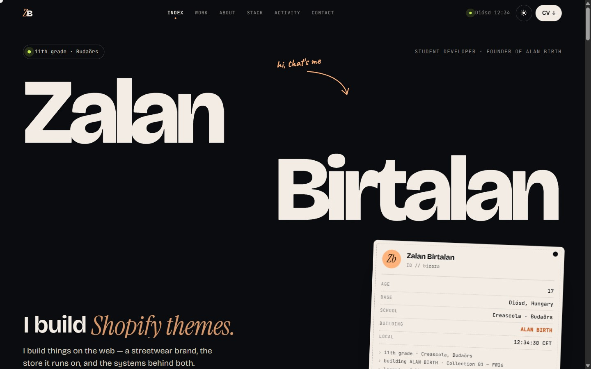

# bizaza-devs.github.io

<picture>
  <source media="(prefers-color-scheme: dark)" srcset="docs/images/portfolio-preview-dark.jpg">
  <source media="(prefers-color-scheme: light)" srcset="docs/images/portfolio-light.jpg">
  
</picture>

Personal portfolio of **Zalan Birtalan** — student developer, founder of ALAN BIRTH.

**v2 — editorial.** Typography first: a giant kinetic name, Bricolage Grotesque with Instrument Serif italics, handwritten SVG annotations, warm cream / ink-black themes and scroll-driven motion (GSAP + ScrollTrigger, with a no-JS-animation fallback). Still **0 images and 0 build steps** — plain HTML, CSS and JavaScript.

## Features
- All content in one file: [`assets/js/data.js`](assets/js/data.js) (the site, `v1.html` and the CV all render from it)
- Hero with rotating "I build …" line and a live ID card, marquee, count-up stats
- Projects as stacked sticky cards, latest public repos pulled live from GitHub
- About with a timeline, "right now" list and interests; skills grouped as using / learning
- **Work activity** — charts in the style of [Bklit UI](https://bklit.com), drawn in plain SVG:
  area chart of daily GitHub contributions vs Claude Code prompts, Code-vs-Claude ring, weekday radar,
  consistency gauge with streaks, sparkline KPIs, languages and recent activity; All / Code / Claude and 30d / 90d / 1y switches
- Claude data: `python scripts/claude_stats.py` aggregates local Claude Code session logs into `data/claude.json` — **only anonymous daily counts** (date, prompts, sessions, tokens), merged with earlier runs so history survives log cleanup; refreshed daily by `scripts/update-activity.ps1`
- Downloadable one-page CV (PDF), generated from the same data: `scripts/build-cv.ps1`
- Dark / light theme (remembers your choice, follows the system by default), custom cursor and magnetic buttons on desktop
- Phone layout with a full-screen menu; responsive down to 320 px, no sideways scrolling
- Hidden command palette (`Ctrl K` / `⌘K` / `/`), copy-email button, scroll progress ring, live local clock
- Respects `prefers-reduced-motion`

## Structure
| Path | What |
|---|---|
| `index.html`, `v2/` | the live site (v2) — `v2/style.css`, `v2/main.js`, `v2/activity.{js,css}` |
| `v1.html`, `assets/css`, `assets/js/main.js` | the previous "Aurora" design, kept for reference |
| `assets/js/data.js`, `assets/js/github.js`, `data/claude.json` | shared data |
| `v2/activity-test.html` | standalone test page for the activity module |

## Run locally
```bash
python -m http.server 5173
# open http://localhost:5173
```

## Deploy
GitHub Pages → Settings → Pages → Deploy from branch → `main` / root.
The site is served at `https://bizaza-devs.github.io`.

## Data sources
- GitHub REST API (public, unauthenticated, cached 10 min in `sessionStorage`)
- Contribution calendar: [github-contributions-api](https://github.com/grubersjoe/github-contributions-api)
