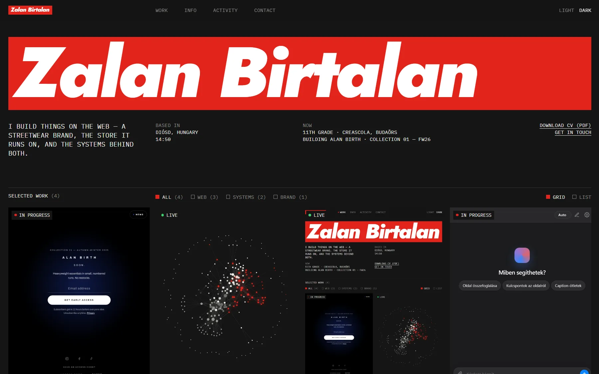

# bizaza-devs.github.io



Personal portfolio of **Zalan Birtalan** — student developer, founder of ALAN BIRTH.

**v3 — index.** The work is the home page: a giant red box logo (streetwear, on purpose), then a lookbook grid of projects in small uppercase mono. Click a project and it opens full-screen with its screenshots, role, numbers and stack — Esc closes, ← → flips through, and every project has its own link (`#work/alanbirth`). Still plain HTML, CSS and JavaScript, no build step.

## Features
- All content in one file: [`assets/js/data.js`](assets/js/data.js) (the site, `v2.html`, `v1.html` and the CV all render from it)
- Work grid with filters (All / Web / Systems / Brand, with counts) and a Grid / List switch; the list shows a floating preview under the cursor
- Project view over the page: real screenshots, role, category, metrics, stack, previous / next, deep links, keyboard and back-button support
- Project images built by [`scripts/build-covers.py`](scripts/build-covers.py): headless-Chrome screenshots of alanbirth.com, the Vivaldi panel and this site, plus the **real link graph of my Obsidian vault** (dots and lines only, no note names)
- Latest public repos pulled live from GitHub
- Info: about, timeline, stack (grey = learning right now), interests
- **Work activity** — the v2 chart module (GitHub contributions vs Claude Code prompts, ring, radar, gauge, sparklines), recoloured for v3
- Claude data: `python scripts/claude_stats.py` aggregates local Claude Code session logs into `data/claude.json` — **only anonymous daily counts**; refreshed daily by `scripts/update-activity.ps1`
- Downloadable one-page CV (PDF), generated from the same data: `scripts/build-cv.ps1`
- Light / dark theme, responsive down to 320 px, visible keyboard focus, respects `prefers-reduced-motion`
- One load moment: the box logo stamps in, then the project images wipe up

## Structure
| Path | What |
|---|---|
| `index.html`, `v3/` | the live site (v3) — `v3/style.css`, `v3/main.js`, images in `v3/img/` |
| `v2.html`, `v2/` | the "editorial" design, kept for reference (`v2/activity.{js,css}` is still used by v3) |
| `v1.html`, `assets/css`, `assets/js/main.js` | the first "Aurora" design, kept for reference |
| `assets/js/data.js`, `assets/js/github.js`, `data/claude.json` | shared data |
| `v2/activity-test.html` | standalone test page for the activity module |

## Run locally
```bash
python -m http.server 5173
# open http://localhost:5173
```

Rebuild the project images (needs Chrome, Pillow, numpy; the local server must be running):
```bash
python scripts/build-covers.py          # graph + screenshots
```

## Deploy
GitHub Pages → Settings → Pages → Deploy from branch → `main` / root.
The site is served at `https://bizaza-devs.github.io`.

## Data sources
- GitHub REST API (public, unauthenticated, cached 10 min in `sessionStorage`)
- Contribution calendar: [github-contributions-api](https://github.com/grubersjoe/github-contributions-api)
